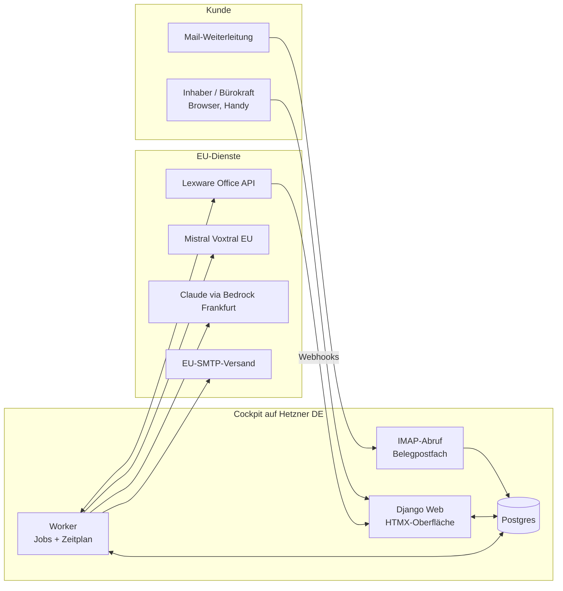

# Architektur

## Überblick

Ein Django-Monolith mit Postgres und einem Hintergrund-Worker. Server-gerenderte Oberfläche mit HTMX. Das Bestandstool (Lexware Office) ist das System of Record für Kunden, Artikel, Rechnungen, Zahlungen und Mahnungsdokumente. Die App hält einen **Spiegel** davon plus eigene Daten (Mahnplan, Vorschläge, Freigaben, Versände, Erfassungen, Protokoll).

## Komponenten

| Komponente | Verantwortung |
| --- | --- |
| `accounts` | Nutzer, Firma, Mitgliedschaft, Rollen, 2FA, Einladungscodes, Rate-Limits |
| `connectors` | Adapter-Schnittstelle `AccountingConnector` plus `LexwareConnector` (später `SevdeskConnector`); Rate-Limit, Retry, Webhook-Empfang, Abgleich |
| `ledger` | Spiegel: Kontakt, Artikel, Beleg (Rechnung/Angebot), Zahlstatus; Altersstruktur, Prognose |
| `dunning` | Mahnplan, Regel-Engine (Verzug, Zinsen, Pauschale), täglicher Vorschlagslauf, Freigabe, Versand |
| `capture` | Erfassung: Upload, Aufnahme, Belegpostfach, Transkription, Extraktion, Regeln, Prüfansicht, Entwurf ins Bestandstool |
| `reports` | Wochenbericht, Export |
| `audit` | Append-only-Protokoll |
| `jobs` | Postgres-basierte Job-Queue (`SELECT … FOR UPDATE SKIP LOCKED`), Zeitplan, Wiederholungen |
| `web` | Seiten, Templates, HTMX-Partials, Rechtstexte |

## Abläufe

1. **Verbinden:** Inhaber gibt Lexware-Schlüssel ein → Testaufruf → Job `initial_sync` → Webhooks registrieren.
2. **Abgleich:** Webhook trifft ein → Signatur prüfen → Job `sync_voucher(id)` → Spiegel aktualisieren. Nachts `full_sync` über `voucherlist`.
3. **Mahnen:** Täglich 5 Uhr `dunning_proposals` je Firma → Vorschläge. Montag 7 Uhr Sammelmail. Freigabe → Job `send_dunning(proposal)` → Frische-Check → ggf. Lexware-Mahnungsentwurf → PDF → Mail → Protokoll.
4. **Erfassen:** Upload/Aufnahme/Mail → `Capture` → Job `transcribe` → Job `extract` → Regeln → Prüfansicht → Freigabe → Job `push_draft` → Lexware-Entwurf → Protokoll.

## Warum ein Monolith

Ein Entwickler, ein Server, wenige hundert Kunden im ersten Jahr. Microservices würden nur Betriebslast erzeugen. Die Adapter-Schnittstelle trennt das Bestandstool sauber, das genügt.

## Job-Queue (umgesetzt in M0-04)

- Tabelle `Job` (typ, payload, firma, status `wartet`/`laeuft`/`erledigt`/`fehler`, versuche, naechster_versuch, gesperrt_bis). Ein `eindeutig_schluessel` ist nur unter aktiven Jobs eindeutig (partieller Unique-Index), damit z. B. ein Webhook-Sturm nur einen Abgleich je Beleg auslöst.
- Worker (`manage.py worker`) holt Jobs mit `SELECT … FOR UPDATE SKIP LOCKED`, sperrt sie für eine Sperrzeit (Standard 300 s) und bricht zu lange Jobs per SIGALRM ab. Hängende Jobs (Sperre abgelaufen, z. B. nach Absturz) werden wieder freigegeben und zählen als Versuch.
- Fehler: exponentieller Backoff 30 s, 60 s, 120 s … höchstens 1 h, plus bis zu 10 % Jitter; `JobAbbruch` beendet ohne Wiederholung.
- Apps melden Jobs in `<app>/aufgaben.py` mit `@job("typ")` an, Zeitplan-Einträge mit `zeitplan(name, cron, typ)`. Cron-Ausdrücke gelten in Europe/Berlin. Je Termin wird genau einmal eingeplant (`ZeitplanLauf`, eindeutig auf Name und Termin), auch bei mehreren Workern. Nach einem Neustart wird nur der jeweils letzte verpasste Termin nachgeholt.
- SIGTERM/SIGINT: der laufende Job wird zu Ende geführt, danach beendet sich der Worker.
- Lebenszeichen in `WorkerLebenszeichen` alle 30 s, ausgewertet vom Health-Endpoint (F4).
